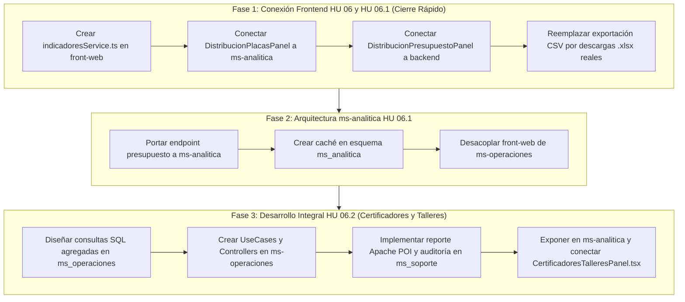

# Estado de Implementación y Pendientes: HU 06, HU 06.1 y HU 06.2

Este documento desglosa el estado actual, el porcentaje de completitud y los **subitems específicos pendientes por componente** para las historias de usuario de indicadores del ecosistema Gazel (Terpel).

---

## 1. Matriz de Estado y Porcentajes

| Historia de Usuario | Backend | Base de Datos | Frontend (UI) | Integración API | % Global Ponderado | Estado General |
| :--- | :---: | :---: | :---: | :---: | :---: | :--- |
| **HU 06** — Indicadores Distribución Placas | 90% | 100% | 90% *(Mock)* | 0% | **~55%** | Backend listo; Frontend maquetado con mock; Falta integración |
| **HU 06.1** — Distribución de Presupuesto | 80% *(en operaciones)* | 100% | 90% *(Mock)* | 0% | **~45%** | Backend en operaciones; Falta en analítica e integración front |
| **HU 06.2** — Certificadores y Talleres | 0% | 20% | 85% *(Mock)* | 0% | **~15%** | UI maquetada con mock; Backend y consultas SQL no iniciados |

---

## 2. Tabla Detallada de Subitems Pendientes por HU

| HU | Componente / Capa | Subitem Pendiente | Descripción Técnica del Trabajo Requerido | Prioridad |
| :--- | :--- | :--- | :--- | :---: |
| **HU 06** | **Frontend (`front-web`)** | Servicio API Indicadores | Crear `indicadoresService.ts` con llamada a `GET /api/v1/indicadores/placas` enviando `programaId`, `anio`, `mes` y headers de auditoría (`X-Usuario-Id`, `X-Rol-Usuario-Id`). | 🔴 Alta |
| **HU 06** | **Frontend (`front-web`)** | Integración del Hook `useIndicadores` | Reemplazar `KPIS_PLACAS` estático de `indicadores.mock.ts` por estado reactivo conectado al API (`data`, `isLoading`, `error`). | 🔴 Alta |
| **HU 06** | **Frontend (`front-web`)** | Gráfica de Serie Temporal Real | Alimentar `GraficaAreaPlacas.tsx` con los 12 meses históricos devueltos por el backend en lugar de datos quemados. | 🟡 Media |
| **HU 06** | **Frontend (`front-web`)** | Descarga Real de Excel (.xlsx) | Reemplazar `exportarCsv` local por llamada binaria a `GET /api/v1/indicadores/placas/excel` que descargue el `.xlsx` generado por Apache POI. | 🔴 Alta |
| **HU 06** | **Backend (`ms-analitica` / `ms-operaciones`)** | Restaurar Autorización CIAM | Reactivar validación de JWT y roles HU10 (`ADMINISTRADOR`) una vez esté disponible el proveedor CIAM/Keycloak. | 🟢 Baja |
| **HU 06.1** | **Backend (`ms-analitica`)** | Portar Endpoints de Presupuesto | Crear `IndicadoresPresupuestoController` y cliente WebClient en `ms-analitica` para no exponer `ms-operaciones` directamente al frontend. | 🔴 Alta |
| **HU 06.1** | **Backend (`ms-analitica`)** | Capa de Caché de Presupuesto | Crear entidad y adaptador de base de datos `indicadores_presupuesto_cache` en esquema `ms_analitica`. | 🟡 Media |
| **HU 06.1** | **Frontend (`front-web`)** | Servicio API de Presupuesto | Implementar en el frontend las llamadas a `/api/v1/indicadores/presupuesto`, `/detalle`, `/excel` y actualización `PUT`. | 🔴 Alta |
| **HU 06.1** | **Frontend (`front-web`)** | Integración Panel Presupuesto | Reemplazar valores mock de Presupuesto, Ejecutado y Disponible en `DistribucionPresupuestoPanel.tsx` por datos del backend. | 🔴 Alta |
| **HU 06.1** | **Frontend (`front-web`)** | Gráficas de Barras Dinámicas | Mapear arrays reales de ejecución por regional y ejecución por taller en `GraficaBarras.tsx`. | 🟡 Media |
| **HU 06.1** | **Frontend (`front-web`)** | Modal de Actualización Concurrente | Conectar formulario de actualización con `PUT` enviando el campo `version` para control de concurrencia optimista. | 🟡 Media |
| **HU 06.1** | **Frontend (`front-web`)** | Modal Detalle con Paginación Server-Side | Conectar tabla de liquidaciones del modal detalle a `GET .../detalle` con paginación server-side (`PageResponse`). | 🟡 Media |
| **HU 06.1** | **Frontend (`front-web`)** | Descarga Real de Excel Presupuesto | Descargar archivo binario `.xlsx` con hojas Resumen y Detalle generado por `ReportePresupuestoExcelService`. | 🔴 Alta |
| **HU 06.1** | **Backend (`ms-facturacion`)** | Consolidación con Facturación | Sincronizar asignaciones presupuestales de `ms_facturacion.presupuesto_programa` con liquidaciones en `ms_operaciones`. | 🟢 Baja |
| **HU 06.2** | **Base de Datos (`ms_operaciones`)** | Consultas SQL Agregadas Certificadores | Diseñar query/vista agrupada por ente certificador, programa, año y mes (Altos consumidores, Vencidos, Placas, Total). | 🔴 Alta |
| **HU 06.2** | **Base de Datos (`ms_operaciones`)** | Consultas SQL Agregadas Talleres | Diseñar query/vista agrupada por taller, programa, año y mes (Placas, Revisión Anual, Revisión Quinquenal, Pago acumulado). | 🔴 Alta |
| **HU 06.2** | **Backend (`ms-operaciones`)** | Puertos y Casos de Uso Backend | Crear `ConsultarIndicadoresCertificadoresUseCase` y `ConsultarIndicadoresTalleresUseCase` con sus servicios y adaptadores. | 🔴 Alta |
| **HU 06.2** | **Backend (`ms-operaciones`)** | Controladores REST | Implementar endpoints `GET /api/v1/admin/indicadores/certificadores` y `GET /api/v1/admin/indicadores/talleres`. | 🔴 Alta |
| **HU 06.2** | **Backend (`ms-operaciones`)** | Generador Excel Apache POI | Crear servicio para generar libros `.xlsx` con el detalle de certificadores y talleres, y registrar auditoría en `ms_soporte`. | 🔴 Alta |
| **HU 06.2** | **Backend (`ms-analitica`)** | Exposición y Caché en Analítica | Exponer endpoints en `ms-analitica` como fachada analítica hacia el frontend con soporte de caché. | 🟡 Media |
| **HU 06.2** | **Frontend (`front-web`)** | Servicio API Certificadores y Talleres | Crear métodos en frontend para invocar búsquedas por certificador y taller con filtros de año, mes y programa. | 🔴 Alta |
| **HU 06.2** | **Frontend (`front-web`)** | Integración de Tablas de Resultados | Conectar tablas con scroll en `CertificadoresTalleresPanel.tsx` reemplazando `FILAS_CERTIFICADORES` y `FILAS_TALLERES` mock. | 🔴 Alta |
| **HU 06.2** | **Frontend (`front-web`)** | Descargas Reales de Excel | Conectar los dos botones de descarga en Excel a los endpoints binarios con manejo de popups de éxito o mensaje de error. | 🟡 Media |

---

## 3. Plan de Acción Secuencial

