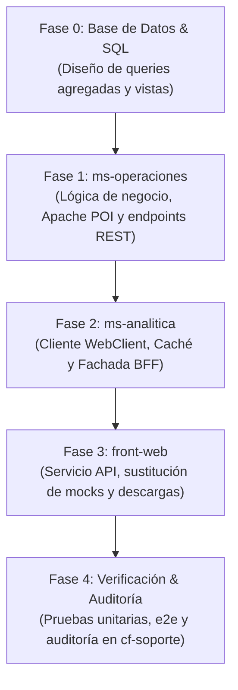

# Plan de Trabajo: Implementación HU 06.2 — Indicadores Certificadores y Talleres

Este documento define el plan de trabajo técnico, arquitectónico y operativo para la implementación integral de la **HU 06.2: Módulo Indicadores Certificadores y Talleres** en el ecosistema Gazel (Terpel).

---

## 1. Alcance y Objetivos Funcionales

| Sección | Filtros Requeridos | Campos de la Tabla / Resultado | Acciones |
| :--- | :--- | :--- | :--- |
| **Certificadores** | • **Ente certificador\*** (Búsqueda obligatoria) • Programa (Desplegable) • Año (Desplegable) • Mes (Desplegable) | • Mes • Año • Altos Consumidores • Vencidos • Placas (Totales) • Total General | • Buscar con validación de campo requerido en rojo • Tabla con scroll horizontal/vertical • Descargar reporte en Excel (.xlsx) con auditoría |
| **Talleres** | • **Taller\*** (Búsqueda obligatoria) • Programa (Desplegable) • Año (Desplegable) • Mes (Desplegable) | • Mes • Placas • Revisión Anual • Revisión Quinquenal • Pago (Monto acumulado liquidado) | • Buscar con validación de campo requerido en rojo • Tabla con scroll horizontal/vertical • Descargar reporte en Excel (.xlsx) con auditoría |

---

## 2. Mapa de Fases de Implementación

---

## 3. Desglose Detallado de Tareas

### 🗄️ Fase 0: Persistencia y Consultas de Agregación (Neon PostgreSQL)
**Repositorio:** `at22pg-portal-revisiones-gazel-terpel-gazel-ms-operaciones`  
**Directorio:** `db/postgresql/`

1. **Análisis de relaciones y volumetría:**
   - Tablas base: `servicios_revisiones`, `aprobaciones_certificador`, `talleres`, `certificadores`, `liquidaciones_talleres`, `catalogo_programas`, `catalogo_tipos_revision`.
2. **Creación de Script de Migración (`V006__indicadores_certificadores_talleres.sql`):**
   - **Query Certificadores:** Agregación por `id_certificador`, `anio`, `mes`, realizando conteos condicionales (`FILTER (WHERE id_programa = '...')`) para Altos Consumidores, Vencidos y total de placas.
   - **Query Talleres:** Agregación por `id_taller`, `mes`, realizando conteos condicionales por tipo de revisión (Anual vs. Quinquenal) y suma del monto de liquidaciones asociadas (`SUM(monto_asignado)`).
   - Creación de índices compuestos si se requieren:
     * `idx_servicios_revisiones_certificador_fecha` sobre `(id_certificador, fecha_servicio)`
     * `idx_servicios_revisiones_taller_fecha` sobre `(id_taller, fecha_servicio)`

---

### ⚙️ Fase 1: Backend en `ms-operaciones` (Fuente de Datos y Reportes)
**Repositorio:** `at22pg-portal-revisiones-gazel-terpel-gazel-ms-operaciones`  
**Paquete:** `co.com.terpel.gazel.operacion`

1. **Capa de Dominio (`domain/model`):**
   - `IndicadorCertificadorItem` (Java 21 `record` con `mes`, `anio`, `altosConsumidores`, `vencidos`, `totalPlacas`, `totalGeneral`).
   - `IndicadorTallerItem` (Java 21 `record` con `mes`, `placas`, `revisionAnual`, `revisionQuinquenal`, `montoPago`).
   - Criterios de validación y excepciones de negocio (`BusinessException`).
2. **Capa de Aplicación (`application`):**
   - **Puertos de entrada:**
     * `ConsultarIndicadoresCertificadoresUseCase`
     * `ConsultarIndicadoresTalleresUseCase`
   - **Puertos de salida:**
     * `ConsultarIndicadoresCertificadoresPort`
     * `ConsultarIndicadoresTalleresPort`
     * `RegistrarDescargaReportePort` (ya existente para auditoría en `ms_soporte`).
   - **Servicios:**
     * `ConsultarIndicadoresCertificadoresService`
     * `ConsultarIndicadoresTalleresService`
3. **Generación de Reportes Excel con Apache POI (`application/service`):**
   - `ReporteCertificadoresExcelService`: genera libro `.xlsx` con encabezados corporativos Terpel y métricas por mes.
   - `ReporteTalleresExcelService`: genera libro `.xlsx` con revisiones anuales/quinquenales y pagos.
4. **Capa de Infraestructura (`infrastructure`):**
   - **Adaptador de Persistencia JPA/JDBC:**
     * Implementar `IndicadoresCertificadoresJpaAdapter` e `IndicadoresTalleresJpaAdapter` usando `NativeQuery` o JDBC `PreparedStatement` para máxima velocidad.
   - **Controlador REST Web (`adapter/in/web`):**
     * `IndicadoresCertificadoresController`:
       - `GET /api/v1/admin/indicadores/certificadores`
       - `GET /api/v1/admin/indicadores/certificadores/excel`
     * `IndicadoresTalleresController`:
       - `GET /api/v1/admin/indicadores/talleres`
       - `GET /api/v1/admin/indicadores/talleres/excel`
5. **Pruebas:**
   - Pruebas unitarias para servicios, cálculos matemáticos y generadores Excel.
   - Pruebas de integración con MockMvc y base H2/PostgreSQL.
   - Meta: 0 fallos en `mvn clean test`.

---

### 📊 Fase 2: Backend en `ms-analitica` (Fachada BFF y Caché)
**Repositorio:** `at22pg-portal-revisiones-gazel-terpel-gazel-ms-analitica`  
**Paquete:** `co.com.terpel.gazel.analitica`

1. **Cliente Web hacia `ms-operaciones` (`adapter/out/client`):**
   - Implementar `OperacionesCertificadoresTalleresClient` inyectando `RestClient`.
   - Manejo resiliente de timeouts y mapeo a DTOs analíticos.
2. **Capa de Caché Analítica (`adapter/out/persistence`):**
   - Guardar las consultas en `ms_analitica.indicadores_cache` con TTL configurable para mitigar sobrecarga en Neon.
3. **Controlador REST Web (`adapter/in/web`):**
   - Exponer:
     * `GET /api/v1/indicadores/certificadores`
     * `GET /api/v1/indicadores/certificadores/excel`
     * `GET /api/v1/indicadores/talleres`
     * `GET /api/v1/indicadores/talleres/excel`
4. **Pruebas:**
   - Pruebas unitarias de controlador y cliente REST.
   - Validación: `mvn clean test` sin regresiones.

---

### 💻 Fase 3: Frontend en `front-web` (Conexión Real de Pantalla)
**Repositorio:** `at22pg-portal-revisiones-gazel-terpel-gazel-front-web`  
**Directorio:** `src/features/indicadores/`

1. **Servicio API (`services/indicadoresCertificadoresTalleresService.ts`):**
   - Métodos `consultarIndicadoresCertificador(filtros)` y `consultarIndicadoresTaller(filtros)`.
   - Métodos de descarga binaria con `responseType: 'blob'` para los dos Excel.
2. **Refactorización de Hook [`useIndicadores.ts`](file:///C:/Users/jaime.cabrera.ext/Documents/Gazel/at22pg-portal-revisiones-gazel-terpel-gazel-front-web/src/features/indicadores/hooks/useIndicadores.ts):**
   - Reemplazar las listas estáticas `FILAS_CERTIFICADORES` y `FILAS_TALLERES` por llamadas asíncronas.
   - Implementar estados: `cargandoCert`, `cargandoTaller`, `errorCert`, `errorTaller`.
   - Mantener las validaciones de UI existentes (mensaje "*campo obligatorio" en rojo cuando no se especifica el ente o taller).
3. **Conexión de Descargas Reales en [`CertificadoresTalleresPanel.tsx`](file:///C:/Users/jaime.cabrera.ext/Documents/Gazel/at22pg-portal-revisiones-gazel-terpel-gazel-front-web/src/features/indicadores/components/CertificadoresTalleresPanel.tsx):**
   - Reemplazar la utilidad `exportarCsv` por la descarga real del blob `.xlsx`.
   - Disparar el modal de confirmación *"¡Documento descargado con éxito! Revisa tu carpeta de descargas"*.
   - Disparar el modal de error si la exportación falla: *"Error de exportación: No se pudo exportar el archivo correctamente..."*.
4. **Pruebas Frontend:**
   - Actualizar y ejecutar suite Vitest en `src/tests/indicadores.test.tsx`.

---

### 🛡️ Fase 4: Auditoría, QA y Cierre
1. **Auditoría Transversal en `cf-soporte`:**
   - Verificar en la tabla `ms_soporte.auditoria_descargas` que cada descarga de Excel registre:
     * `tipo_reporte`: `INDICADORES_CERTIFICADORES` o `INDICADORES_TALLERES`.
     * `id_usuario`, `rol_usuario`, `parametros_consulta` y marca de tiempo.
2. **Actualización de OpenAPI:**
   - Documentar los nuevos endpoints en `openapi/operaciones.yaml` y `openapi/analitica.yaml`.
3. **Prueba Integral End-to-End (E2E):**
   - Flujo completo: Búsqueda desde la web -> BFF Analítica -> Operaciones -> Base de datos Neon -> Descarga Excel -> Auditoría en soporte.

---

## 4. Matriz de Entregables por Repositorio

| Repositorio | Archivos Clave a Crear / Modificar |
| :--- | :--- |
| **`ms-operaciones`** | • `db/postgresql/V006__indicadores_certificadores_talleres.sql` • `IndicadorCertificadorItem.java`, `IndicadorTallerItem.java` • `ConsultarIndicadoresCertificadoresUseCase.java`, `ConsultarIndicadoresTalleresUseCase.java` • `ConsultarIndicadoresCertificadoresService.java`, `ConsultarIndicadoresTalleresService.java` • `ReporteCertificadoresExcelService.java`, `ReporteTalleresExcelService.java` • `IndicadoresCertificadoresController.java`, `IndicadoresTalleresController.java` • Pruebas unitarias correspondientes |
| **`ms-analitica`** | • `OperacionesCertificadoresTalleresClient.java` • `IndicadoresCertificadoresTalleresController.java` • Servicios y configuración de caché en `ms_analitica` • Pruebas unitarias de integración |
| **`front-web`** | • `src/features/indicadores/services/indicadoresCertificadoresTalleresService.ts` • Adaptación de `useIndicadores.ts` • Conexión de `CertificadoresTalleresPanel.tsx` a llamadas reales y descarga binaria • Actualización de pruebas en `src/tests/indicadores.test.tsx` |

---

## 5. Estimación y Dependencias

* **Dependencias previas:** Disponibilidad de datos de prueba en Neon (talleres, certificadores y servicios registrados con revisiones anuales/quinquenales).
* **Riesgos controlados:** 
  * Rendimiento en queries de agregación (mitigado con índices en PostgreSQL y caché en `ms-analitica`).
  * Timeout en generación de Excel con grandes volúmenes (mitigado con paginación/filtros obligatorios de Ente y Taller).
